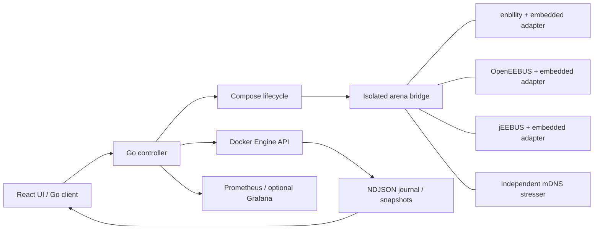

# Architecture and scope

The controller is a Go HTTP server and headless client. It uses only the
standard library. Docker Compose creates one container per node, on a private
internal bridge per arena. Identities are mounted read-only; native pairing state
has a separate writable mount. Every node has its
own network namespace, so all nodes can use the same SHIP and mDNS ports. mDNS
stays inside the bridge, so no host multicast forwarding is needed.

Schema v3 extends v2, which separates intended links, startup trust, and native learned trust.
The controller provisions pairing credentials and drives native APIs. Native
observations establish trust and readiness; command success alone does not.
V1 setups retain pre-trusted behavior. Pairing state survives container recreation.
Event expectations track an incarnation and interval; telemetry gaps prevent an
absence pass. See [pairing tests](pairing-testing.md).

The stresser joins the bridge's IPv4 interface explicitly and drops all Linux
capabilities. Its public config mount contains no certificates or secrets.

## Adapters

An adapter reads newline-delimited JSON commands from stdin and writes
structured events to stdout. Upstream logs go to stderr. The controller sends
commands through Docker attach, so a node needs no extra process, HTTP server or
published port. This keeps the per-node overhead low at 100-200 nodes.

Adapters are specific to their stack. They share capabilities, command IDs,
incarnation IDs and monotonically increasing event sequences.

A command returns the native result where the upstream API gives one. Receiver
snapshots and callbacks are separate observations. A successful write on the
sender does not prove that the receiver applied the limit.

No adapter adds its own LPC/LPP state machine. Java uses the public CS state
machine. Go and C expose the behavior of their existing demos and report the
missing state coverage as a gap.

## Telemetry and evidence

- The controller follows the Docker log streams, drops replayed sequences, flags
  missing sequences, and matches commands to the node and process incarnation.
  Saved log cursors skip replay on controller restart; retired incarnations cannot
  overwrite current observations. Lifecycle restarts clear observation readiness.
- Snapshots are journalled when they change. Resource samples remain available in
  state and Prometheus, and mDNS observations contain counts rather than full lists.
- Live history keeps 4,000 events. A slow SSE client reconnects and gets an
  explicit history-gap or controller-epoch gap event. The UI keeps 1,500 relevant events.
- Each arena journal keeps three files of up to about 64 MiB. A rotation is
  recorded as retention loss, separate from protocol message loss. Docker keeps
  three 16 MiB log files per node.

These are retention limits, not packet-drop estimates.

Run snapshots are serialized under the state lock, then saved by a single writer
outside it. Temporary JSON files and their directories are synced around atomic
renames. Start, Stop, Drop and shutdown drain pending writes. Unreadable runs stay
visible as `corrupt`; Drop archives their original files and Restore preserves them.

Run configuration, identities, composition, assertion outcomes, runtime
snapshots and events are stored in `.arena/runs/RUN_ID`. An import validates
certificate/key pairs, SKI derivation, uniqueness, trust topology and exact
image IDs. Certificates use ECDSA P-256 and the SHIP SKI derivation. Identities
are generated once at random and then kept in the bundle. The seed controls only
the workload choices.

## Resource analysis and execution

A small supervisor wraps each native adapter and serializes native output with
an independent resource stream. Local `/proc` identifies processes by collector
incarnation, PID and start ticks; `/proc` and cgroup v2 counters use measured real
intervals. Avahi, D-Bus, native stack and collector costs remain separate. Docker
stats provide container fallback. CPU 100% means one logical CPU; RSS is not heap
or a sum-safe container total. Device metrics explicitly describe the whole lab
device. Missing fields stay unavailable.

Raw resource history uses three 32 MiB segments and a bounded writer queue.
Discarded raw segments are compacted into minute min/max/weighted mean/last/count
and coverage, preserving sampled peaks. Compaction failure retains raw data and
reports a write failure. One extra 32 MiB segment of active headroom preserves new
readings while retries are limited to once per minute; exhausted headroom increments
`retentionDrops` and never permits unbounded growth. Aggregate storage is capped at
256 MiB. Read barriers do not sync disks; dirty files and metadata sync every 15
seconds, on explicit flush/export and shutdown. Partial minute
query boundaries produce gaps. Requests cap series, points and gaps and report
truncation. Samples do not enter the live native journal. Evidence imports reopen
retained data as archived runs with no control capability or executable identities.

Group and node limits configure CPU quota, hard RAM plus equal memory+swap
(no extra swap), and process count. Omitted overrides inherit; explicit zero is
unlimited. Runtime inspection verifies exact requested values and records OOMs.
External nodes cannot inherit container constraints.

Campaign lanes form a validated dependency graph with at most eight workers.
Offsets and waits carry a real or protocol domain. Resource windows and network
fault lifetimes always use real time. Mutating actions share a per-node gate.
Stateful exploration chooses only available native actions from fresh observations;
seeds and actual enabled sets/choices are retained. Neither runner supplies native
use-case state. See [configuration and examples](expansion.md).

Network helpers join only a verified owned container namespace. They drop all
capabilities except NET_ADMIN, have strict resource/lifetime bounds, and filter one
peer IPv4 flow. mDNS ingress uses a lease-labelled IFB. Application, kernel counters
and restoration are native helper evidence. Leases persist across controller
restart. A second bounded helper can recover reserved rules after an abrupt helper
exit; cleanup without verified evidence keeps the lease and its failure visible.
No host qdisc or physical device interface is modified.

Physical runs use an explicit macvlan lab interface, subnet and reserved address
pool. A pinned TLS/token lab agent runs the configured native stub on its explicit
device interface. Its native commands, trust and resources enter the same evidence
contracts, with host receipt time and original device UTC both retained. The current
SMGw uses a temporary enbility stub, not STAG; it has no firmware or power controls.

## Timing profiles

Real time is the currently qualified reference. Faster factors 2×, 5× and 10×
require a versioned build declaration covering SHIP, pairing, SPINE, discovery,
participating dependencies and persistence for the selected profile. The old
partial heartbeat hooks and `timing.accelerated` flag do not meet that contract.
They cannot enable a faster run. Physical runs require 1×.

Full native clocks, Avahi/dependency coverage, runtime acknowledgement/drift and
behavioral equivalence tests are still outstanding. The controller records real
UTC receipt and protocol elapsed time separately, and keeps collection, cleanup,
workload rate and physical latency in real time. It never changes host/device UTC
to accelerate a test. See the [clock implementation target](expansion-plan.md#reliable-time-acceleration-across-stacks).

## Boundaries and later work

Compose is the first backend because a Linux bridge gives mDNS a simple
multicast domain. A Kubernetes backend would keep the identity, capability,
command/event and scenario contracts. It must first pick and test a CNI with
multicast support. There are no Kubernetes manifests today.

Windows and macOS can run the Linux containers through Docker Desktop. WSL2 is
the recommended launcher on Windows. Path translation, multicast inside the VM,
resource attribution and ARM emulation need their own smoke tests. Only Linux
has been verified.

Directional IPv4 and IPv6 impairments are implemented inside owned container
namespaces. IPv6 mDNS source inspection is read-only and ephemeral. Native MGCP
and MPC remain in the Go/C stacks; the controller validates provider selection
and compares received native readings. See [network and monitoring](network-monitoring.md).
Physical-side enforcement, power interruption and complete accelerated clocks
remain later work.

No patches have been sent upstream. The repo keeps the overlays and provenance
for review.
